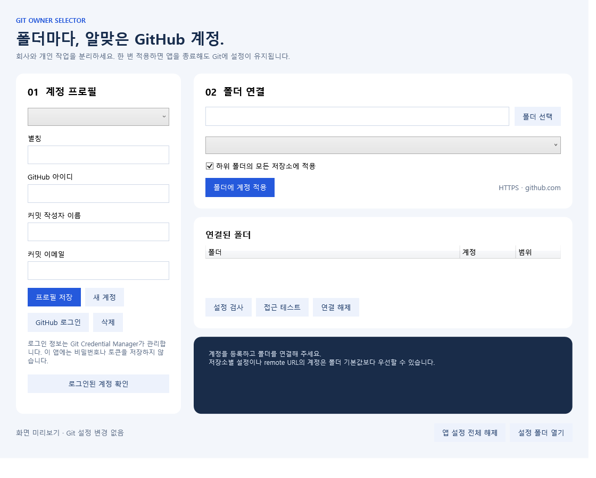

# Git Owner Selector

**폴더를 선택하고, GitHub 계정을 연결하세요.**

회사 계정과 개인 계정을 함께 사용하는 개발자를 위한 Windows 데스크톱 앱입니다. 폴더별로 커밋 작성자와 GitHub HTTPS 인증 기본 계정을 지정해, 터미널에서 작업할 때 계정을 반복해서 선택하는 번거로움을 줄입니다.

Set a default GitHub account for each folder on Windows, with a desktop UI for commit identity and HTTPS authentication settings.



> 현재 버전은 **Windows Git + GitHub.com + HTTPS** 환경을 지원합니다. 앱을 종료해도 설정은 유지됩니다. 최초 로그인, 인증 만료, 조직의 SSO 정책에 따른 재인증은 필요할 수 있습니다.

[시작하기](#시작하기) · [입력값 안내](#입력값-안내) · [자주 묻는 질문](#자주-묻는-질문) · [개발 및 테스트](#개발-및-테스트) · [배포 안내](docs/RELEASING.md)

## 이런 상황에 사용하세요

```text
D:\Projects\
├─ work\                → 회사 GitHub 계정
│  ├─ backend\
│  └─ dashboard\
└─ personal\            → 개인 GitHub 계정
   ├─ blog\
   └─ side-project\
```

상위 폴더에 계정을 한 번 연결하면 하위의 일반 Git 저장소에 같은 기본값이 적용됩니다. 특정 하위 폴더나 저장소만 다른 계정을 사용하도록 예외를 둘 수도 있습니다.

## 주요 기능

| 기능 | 설명 |
| --- | --- |
| 계정 프로필 | 회사·개인 등 여러 계정의 사용자명, 커밋 이름, 이메일 관리 |
| GitHub 로그인 | Git Credential Manager를 통한 브라우저 로그인 |
| 폴더별 기본 계정 | 선택한 저장소만 적용하거나 하위 저장소까지 일괄 적용 |
| 하위 폴더 예외 | 더 구체적인 폴더 규칙을 우선 적용 |
| 설정 검사 | 현재 작성자와 인증 기본값, 저장소 자체 설정 및 remote 충돌 확인 |
| 접근 테스트 | origin의 push 주소에 대한 원격 읽기 접근 확인 |
| 설정 해제·백업 | 개별 연결 또는 앱 전체 연결 해제, 변경 전 설정 백업 |

## 시작하기

### 1. 실행 환경 준비

| 항목 | 요구 사항 |
| --- | --- |
| 운영체제 | Windows 데스크톱 환경, WPF 실행 가능 |
| Git | [Git for Windows](https://gitforwindows.org/) 및 Git Credential Manager |
| 실행용 런타임 | [.NET 9 Desktop Runtime](https://dotnet.microsoft.com/en-us/download/dotnet/9.0)의 Windows용 설치본 |
| 소스 빌드 | .NET 9 SDK |
| 원격 저장소 | `https://github.com/OWNER/REPOSITORY.git` 형태 |

터미널에서 다음 명령이 실행되는지 확인합니다.

```powershell
git --version
git credential-manager --version
```

일반 .NET Runtime만 설치되어 있다면 WPF 실행에 필요한 **Desktop Runtime**도 설치해야 합니다.

### 2. 앱 실행

**배포 파일을 받은 경우:** ZIP 전체를 압축 해제하고 `GitOwnerSelector.exe`를 실행합니다. EXE 옆의 DLL·설정 파일도 함께 보관하세요. 배포 파일 제공 여부는 저장소의 Releases에서 확인할 수 있습니다.

**소스를 받은 경우:** 프로젝트 루트에서 `Launch.cmd`를 실행합니다. 로컬 배포 파일이 있으면 실행하고, 없으면 .NET SDK로 빌드 후 실행합니다. 직접 실행할 수도 있습니다.

```powershell
dotnet run --project src/GitOwnerSelector/GitOwnerSelector.csproj -c Release
```

### 3. 계정 등록 및 로그인

1. **계정 프로필**에서 별칭, GitHub 아이디, 커밋 작성자 이름, 커밋 이메일을 입력합니다.
2. **프로필 저장**을 누릅니다.
3. **GitHub 로그인**을 누르고 브라우저에서 해당 계정으로 인증합니다.
4. **로그인된 계정 확인**으로 등록 상태를 확인합니다.
5. **새 계정**을 눌러 다른 계정도 등록합니다.

브라우저에 다른 계정으로 로그인되어 있다면 인증할 계정을 확인한 뒤 진행하세요.

### 4. 폴더와 계정 연결

1. **폴더 선택**으로 작업 폴더를 선택합니다.
2. 연결할 계정을 선택합니다.
3. **하위 폴더의 모든 저장소에 적용**을 체크하면 선택한 폴더와 그 아래의 저장소에 적용합니다. 체크를 해제하면 선택한 저장소에만 적용하며, 저장소 최상위 폴더를 선택해야 합니다.
4. **폴더에 계정 적용**을 누릅니다.
5. **설정 검사**에서 실제 Git 저장소를 선택해 적용 결과를 확인합니다.

이후 해당 저장소의 터미널에서 평소처럼 `git commit`, `git pull`, `git push`를 사용하면 됩니다. 동일한 경로·범위로 다시 적용하면 기존 연결을 교체합니다.

## 입력값 안내

| 입력 항목 | 무엇을 넣나요? | 예시 |
| --- | --- | --- |
| 별칭 | 앱에서 구분하기 위한 자유로운 이름 | `회사`, `개인` |
| GitHub 아이디 | 프로필 주소 `github.com/사용자명`의 사용자명. 로그인 이메일이나 프로필 표시 이름이 아닙니다. `@` 없이 입력합니다. | `my-personal-account` |
| 커밋 작성자 이름 | 커밋 기록에 표시할 이름. 실명이나 닉네임을 사용할 수 있습니다. | `Hong Gildong` |
| 커밋 이메일 | 사용할 GitHub 계정에 등록·인증된 이메일 또는 그 계정의 GitHub 제공 `noreply` 주소 | GitHub 설정에서 확인한 실제 주소 |

**GitHub 아이디는 인증 계정을 선택하고, 커밋 이메일은 커밋을 GitHub 계정에 연결하는 데 사용됩니다.** 커밋 이름과 이메일만 바꾸는 것으로 push 인증 계정이 바뀌지는 않습니다.

이메일은 GitHub **Settings → Emails**에서 확인하세요. 이메일 공개를 원하지 않으면 해당 화면의 `noreply` 주소를 그대로 복사합니다. 앱은 이메일의 GitHub 등록·인증 여부를 자동으로 확인하지 않습니다. 자세한 내용은 [GitHub 커밋 이메일 안내](https://docs.github.com/en/account-and-profile/how-tos/email-preferences/setting-your-commit-email-address)를 참고하세요.

## 동작 방식

앱이 Git 명령을 대신 실행하는 상주 프로그램은 아닙니다. Git이 직접 읽는 설정 파일을 생성합니다.

```text
사용자 전역 Git 설정
  └─ include.path → 앱의 folders.gitconfig
       └─ includeIf "gitdir/i:폴더 경로/"
            └─ 계정별 프로필
                 ├─ user.name / user.email
                 └─ GitHub HTTPS 인증 사용자명 / GCM helper
```

- 전역 Git 설정에 앱 관리 파일을 읽는 `include.path`를 추가합니다.
- 폴더 조건에 맞는 프로필의 작성자 정보와 `credential.https://github.com.username`을 읽습니다.
- 해당 호스트의 credential helper 목록을 초기화한 뒤 `manager`를 지정하여 Git Credential Manager를 사용합니다.
- 앱 규칙끼리는 더 구체적인 하위 폴더가 우선하고, 같은 폴더에서는 저장소 전용 규칙이 우선합니다.
- 저장소의 기존 설정이나 remote 주소는 자동으로 수정하지 않습니다.

구현 기반: [Git 조건부 설정](https://git-scm.com/docs/git-config#_includes) · [Git Credential Manager 다중 계정](https://github.com/git-ecosystem/git-credential-manager/blob/main/docs/multiple-users.md)

## 지원 범위와 제한

| 상황 | 현재 동작 |
| --- | --- |
| GitHub.com HTTPS 저장소 | 폴더별 인증 기본 계정 지정 지원 |
| SSH 주소 (`git@github.com:...`) | 인증 계정 지정 미지원. 설정 검사에서 안내 |
| GitHub Enterprise·GitLab 등 | 인증 설정 대상 아님 |
| 하위 폴더에 새로 만든 일반 저장소 | 해당 폴더 규칙 적용 |
| 최초 `git clone` 인증 | 폴더 규칙만으로 인증 계정 선택을 보장하지 않음 |
| WSL 내부 Git | 별도 Git 환경이므로 이 앱의 관리 대상 아님 |
| Git worktree | 작업 폴더가 아닌 Git 메타데이터 경로 기준으로 매칭. 필요하면 저장소 전용 규칙으로 등록 후 검사 |
| `[`, `]`, `*`, `?`가 포함된 폴더 경로 | 현재 미지원 |

저장소 자체 설정, 명령의 `-c` 옵션, 환경 변수, 더 구체적인 URL별 credential 설정, remote URL에 포함된 사용자 정보는 폴더 기본값보다 우선할 수 있습니다. **설정 검사**를 통해 실제 적용 결과를 확인하세요.

**접근 테스트는 쓰기 권한이나 실제 push 계정을 보증하지 않습니다.** origin의 push 주소에 `git ls-remote`를 실행하는 읽기 테스트이며, 공개 저장소는 익명으로도 성공할 수 있습니다. 앱이 테스트 목적으로 커밋을 만들거나 push하지는 않습니다.

## 자주 묻는 질문

### 앱을 계속 켜 두어야 하나요?

아니요. Git 설정을 저장하므로 앱을 종료하거나 PC를 재시작해도 유지됩니다.

### 계정을 지정했는데도 로그인이나 계정 선택 창이 떠요.

**로그인된 계정 확인**에서 계정이 등록되어 있는지 확인한 뒤 **설정 검사**를 실행하세요. SSH 주소인지, remote URL에 다른 사용자명이 들어 있는지, 저장소 자체 인증 설정이 있는지 확인할 수 있습니다. 인증 만료나 조직 SSO 정책에 따라 재인증이 필요할 수도 있습니다.

### 커밋 이메일이 바뀌지 않아요.

저장소 자체에 지정된 `user.email` 등이 폴더 기본값보다 우선할 수 있습니다. **설정 검사**는 값과 설정 출처를 표시합니다. 터미널에서도 저장소 안에서 확인할 수 있습니다.

```powershell
git config --show-origin --get user.name
git config --show-origin --get user.email
git config --get-urlmatch credential.username https://github.com
```

마지막 명령은 호스트에 대한 설정값을 확인하며, 실제 원격 인증 성공 여부를 확인하는 명령은 아닙니다.

### 기존 커밋의 작성자도 변경되나요?

아니요. 적용 이후 새로 작성하는 커밋의 기본값이 바뀝니다. 기존 커밋 기록은 수정하지 않습니다.

### GitHub 아이디가 조직 이름인가요?

아니요. 로그인할 **사용자 계정의 사용자명**입니다. 저장소 소유 조직 이름과 다를 수 있습니다.

### 프로그램이 실행되지 않아요.

.NET 9 **Desktop Runtime** 설치 여부와 배포 폴더의 파일 누락 여부를 확인하세요. 소스에서 실행한다면 .NET 9 SDK가 필요합니다. Git 또는 GCM 오류가 표시되면 먼저 위의 버전 확인 명령을 실행해 보세요.

## 설정 해제 및 데이터 보관

| 작업 | 결과 |
| --- | --- |
| 연결 해제 | 선택한 폴더 규칙 제거. 기존 기본값 또는 상위 폴더 규칙 적용 |
| 앱 설정 전체 해제 | 앱이 추가한 전역 include 연결 제거. 프로필과 폴더 목록은 보관 |
| 프로필 삭제 | 앱의 프로필만 삭제. 연결된 폴더부터 해제해야 함 |

전체 해제 후 다시 사용하려면 **폴더에 계정 적용**을 누릅니다. 계정 프로필 삭제나 설정 해제는 GCM에 저장된 GitHub 로그인 정보를 삭제하지 않습니다.

데이터는 `%LOCALAPPDATA%\GitOwnerSelector`에 저장됩니다. **설정 폴더 열기**로 확인할 수 있습니다.

```text
GitOwnerSelector/
├─ settings.json         # 프로필과 폴더 규칙
├─ folders.gitconfig     # 폴더별 include 조건
├─ profiles/             # 생성된 계정별 Git 설정
└─ backups/              # 수정 전 설정 백업
```

앱은 인증 토큰이나 비밀번호를 직접 저장하지 않고 GCM에 인증을 맡깁니다. 앱 설정에는 이름·이메일·로컬 경로가 포함되고, 백업에는 기존 Git 설정이 포함됩니다. 이 파일들은 공개 저장소나 이슈에 첨부하지 마세요.

앱을 삭제하기 전 **앱 설정 전체 해제**를 실행하세요. 이 작업으로 다른 Git 설정을 백업 시점의 내용으로 덮어쓰지 않고, 앱의 설정 연결만 제거합니다.

## 개발 및 테스트

C# / .NET 9 / WPF로 작성되었습니다. 외부 NuGet 패키지를 사용하지 않습니다. 아래 명령은 프로젝트 루트에서 실행합니다.

```powershell
# 빌드
dotnet build src/GitOwnerSelector/GitOwnerSelector.csproj -c Release

# 실제 Git 명령을 사용하는 통합 검증
dotnet run --project tests/GitOwnerSelector.Tests/GitOwnerSelector.Tests.csproj -c Release

# 런타임 별도 설치 방식으로 배포 폴더 생성
dotnet publish src/GitOwnerSelector/GitOwnerSelector.csproj -c Release --self-contained false -o dist/GitOwnerSelector
```

테스트 프로젝트는 별도의 콘솔 검증 프로그램입니다. `dotnet test` 대신 위의 `dotnet run` 명령을 사용합니다. 프로젝트의 `.test-work` 아래에 임시 저장소와 전용 전역 Git 설정을 생성하며 실제 사용자 Git 설정은 변경하지 않습니다.

현재 26개 검증 항목은 계정별 기본값, 중첩·저장소 전용 규칙, 기존 설정 보존, 설정 충돌 감지, 설정 해제, 저장 실패 복구 등을 다룹니다. 브라우저 로그인과 실제 GitHub push는 자동 검증 범위에 포함하지 않습니다.

```text
src/
├─ GitOwnerSelector/          # WPF UI, 계정·폴더 관리
└─ GitOwnerSelector.Core/     # Git 실행, 프로필, 설정 생성·검사
tests/
└─ GitOwnerSelector.Tests/    # 독립 환경에서 실행하는 통합 검증
docs/
├─ images/                   # README 화면 이미지
└─ RELEASING.md              # 공개 및 배포 절차
```

개발 환경과 검증 방법은 [CONTRIBUTING.md](CONTRIBUTING.md), ZIP 배포 및 화면 이미지 갱신 방법은 [배포 안내](docs/RELEASING.md)를 참고하세요.

## 문제 제보

재현 순서, 기대한 결과, 실제 결과, Git/GCM/.NET 버전과 remote의 HTTPS·SSH 여부를 함께 알려 주세요. 계정 이름, 이메일, 회사 저장소 주소와 로컬 경로는 필요한 부분만 익명화하고, 인증 정보나 설정 백업 전체를 첨부하지 마세요.
